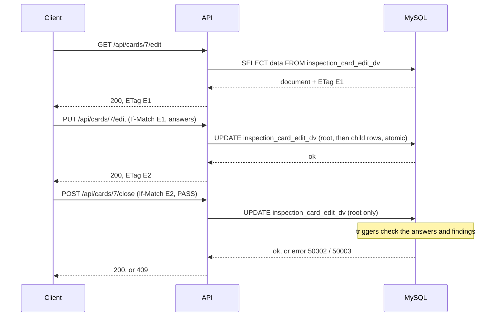

# API reference (demo)

Base path `/api`. JSON in and out. Demo authentication only. Source: [api/](../../api/). Recorded requests and
responses: `docs/api/example-transcript.md` (written by `npm run examples`).

## Why the API looks like this

The database does the work that matters: two Duality Views serve and accept the documents, and triggers, CHECK
constraints and a unique index enforce the rules (see `docs/decisions/decision-log.md`, D-023 to D-025). The API only
turns HTTP into SQL and database errors into HTTP answers. Three observed MySQL behaviors shape it:

1. **The ETag belongs to the view.** The read view and the edit view give the same card different ETags. A client reads
   the edit document to get the ETag it sends back (D-023, D-024).
2. **A document write is atomic and writes the root before its children.** Closing a card with its answers in one write
   fails, because the close rule sees the old answers. So closing takes two writes (D-024).
3. **Database rules apply to JSON writes**, with their own error numbers, so the API can map them (D-023 to D-025).

## Authentication

Send `X-Demo-User: <username>` on every request except `GET /api/health`. The seeded users are `inspector1`,
`inspector2` (role INSPECTOR) and `supervisor1` (role SUPERVISOR). Missing or unknown user: 401. A SUPERVISOR-only
endpoint called by an INSPECTOR: 403. This is not security; it shows where a real login would plug in (D-010).

## Endpoints

| Method and path | Role | What it does | Database object |
|---|---|---|---|
| `GET /api` | none | A short self-description and the endpoint list (a browser visit lands here) | none |
| `GET /api/health` | none | `{"status":"ok"}` | none |
| `GET /api/cards` | any | `{"cards":[{card_id, card_status, disposition, unit_serial}]}` | `inspection_card_dv` |
| `GET /api/cards/:id` | any | Full read document; `ETag` of the read view; `Link: </api/cards/:id/edit>; rel="edit"` | `inspection_card_dv` |
| `GET /api/cards/:id/edit` | any | Edit document; `ETag` of the edit view | `inspection_card_edit_dv` |
| `PUT /api/cards/:id/edit` | any | Write answers and measurements; needs `If-Match` | `UPDATE inspection_card_edit_dv` |
| `POST /api/cards/:id/close` | SUPERVISOR | Close the card; needs `If-Match` | `UPDATE inspection_card_edit_dv` |
| `POST /api/cards` | any | Open a card on a unit: 201, `Location`, read document | plain `INSERT` (a trigger adds the PENDING rows) |

### Request bodies

`PUT /api/cards/:id/edit`: at least one of the three keys; nothing else is accepted.

```json
{
  "card_status": "IN_PROGRESS",
  "checklist": [ { "checklist_result_id": 19, "answer_code": "YES" } ],
  "measurements": [ { "measurement_result_id": 19, "result_status": "RECORDED", "measured_value": 1000.125 } ]
}
```

- `answer_code`: `PENDING`, `YES`, `NO`, `NOT_APPLICABLE`. `result_status`: `PENDING`, `RECORDED`, `NOT_APPLICABLE`.
- `measured_value` is required for `RECORDED` (at most 7 digits before and 3 after the point) and must be absent otherwise.
- The server fills who answered or recorded and when, in UTC. The client never sends them.
- An entry that changes nothing is left untouched, so repeating a request changes nothing.

`POST /api/cards/:id/close`: `{"disposition":"PASS"}` or `{"disposition":"REJECT"}`. Both set the status `CLOSED` and go
through the same database close rules. The status `REJECTED` is not reachable through the API (open question D-011).

`POST /api/cards`: `{"unit_serial":"SN-DEMO-0002"}`.

## Closing a card takes two writes



If the ETag is stale at any step, the API answers 412 with the current document so the client can show both versions.

## Errors

Body: `{"error":{"code":"...","message":"...","db_errno":1234}}`. `db_errno` is present only when a database error
caused the answer. A 412 body also holds `current: {etag, document}`.

| HTTP | `code` | Cause | Source |
|---|---|---|---|
| 400 | `UNKNOWN_PROPERTY`, `INVALID_JSON`, `INVALID_BODY`, `INVALID_ID`, `INVALID_IF_MATCH` | The request is malformed. The API never forwards a property it does not know, so MySQL error 6489 should not happen | API validation; 6489 |
| 401 | `UNAUTHENTICATED`, `UNKNOWN_USER` | No or unknown `X-Demo-User` | API |
| 403 | `FORBIDDEN` | The user's role may not do this | API |
| 404 | `CARD_NOT_FOUND`, `NOT_FOUND` | No such card or endpoint | API |
| 405 | `METHOD_NOT_ALLOWED` | `Allow` header lists the methods | API |
| 409 | `CHECKLIST_INCOMPLETE` | An unanswered checklist item blocks the close | trigger, error 50002 |
| 409 | `CRITICAL_FINDING_OPEN` | An open CRITICAL finding blocks the close | trigger, error 50003 |
| 409 | `CARD_FINAL` | A closed card cannot be changed. Closing a closed card again is answered by the API itself; every other write is answered by the lock | API check; lock triggers, errors 50020 to 50022 |
| 409 | `ACTIVE_CARD_EXISTS` | The unit already has an open card | unique index, error 1062 |
| 412 | `STALE_ETAG` | The card changed after it was read | Duality View, error 6494 |
| 413, 415 | `BODY_TOO_LARGE`, `UNSUPPORTED_MEDIA_TYPE` | Body over 64 KB, or not `application/json` | API |
| 422 | `INVALID_VALUE`, `EMPTY_EDIT`, `DUPLICATE_ENTRY`, `UNKNOWN_RESULT`, `UNKNOWN_UNIT` | A value or id is wrong | API validation |
| 422 | `RULE_VIOLATED`, `REFERENCE_VIOLATED` | A CHECK constraint or foreign key refused it | errors 3819, 1452 |
| 428 | `IF_MATCH_REQUIRED` | A write without `If-Match` | API |
| 500 | `INTERNAL_ERROR`, `READ_ONLY_WRITE` | A bug or an unexpected database error; no details are returned | error 6497 or other |

Only the error number decides the mapping. The text of a database error is never forwarded; the one exception is the
constraint name and the document path, which carry no schema or credential information.

## Example requests (POSIX shell; on Windows PowerShell use `npm run examples`, which avoids the quoting problems of `curl.exe`)

```sh
curl -i -H "X-Demo-User: inspector1" http://127.0.0.1:3000/api/cards/1

curl -i -X POST -H "X-Demo-User: inspector1" -H "Content-Type: application/json" \
     -d '{"unit_serial":"SN-DEMO-0002"}' http://127.0.0.1:3000/api/cards

curl -i -H "X-Demo-User: inspector1" http://127.0.0.1:3000/api/cards/3/edit        # note the ETag

curl -i -X PUT -H "X-Demo-User: inspector1" -H "Content-Type: application/json" -H 'If-Match: "<etag>"' \
     -d '{"checklist":[{"checklist_result_id":11,"answer_code":"YES"}]}' http://127.0.0.1:3000/api/cards/3/edit

curl -i -X POST -H "X-Demo-User: supervisor1" -H "Content-Type: application/json" -H 'If-Match: "<etag>"' \
     -d '{"disposition":"PASS"}' http://127.0.0.1:3000/api/cards/3/close
```

## What the API deliberately does not do

- No real authentication or authorization (D-010).
- No endpoints for production units, findings or attachments, and no `INSERT` or `DELETE` through a view.
- It does not check whether a card is final, with one exception: closing a card that is already closed is refused by the
  API itself. The database accepts a write that changes nothing, so the same repeated close would be a silent no-op within
  the same second and error 50020 a second later (found by the first integration run). Every other write to a final card is
  answered by the database lock. A repeated write that changes nothing (for example the same answers again) returns 200
  and leaves the card as it was.
- Timestamps the server writes (who answered, when) are UTC, truncated to whole seconds; the card tables keep no fractions.
- A card whose measurement or checklist array is JSON `null` (no result rows) is written back as `null`; this case was
  not tested, and cards opened through the API always have result rows.
- It was written against MySQL 9.7.2 Community. Other versions may differ (see the version notes in the decision log).
