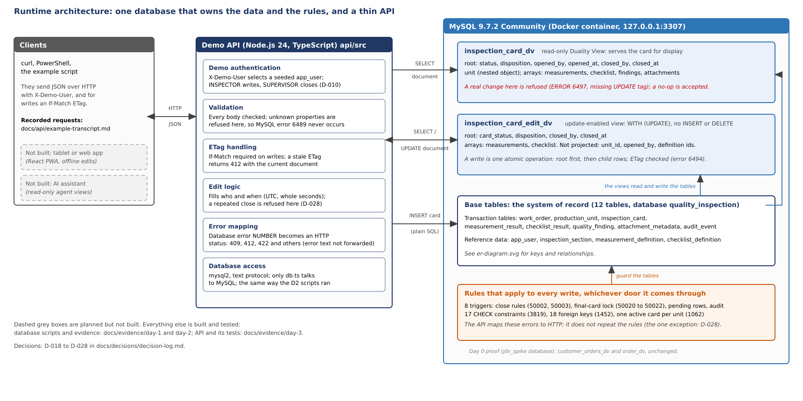
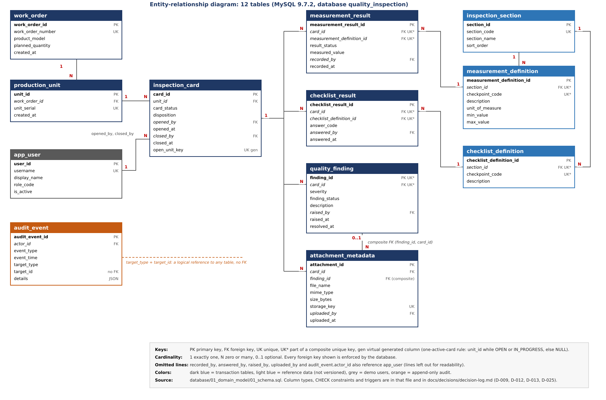

# Architecture and data model

Two diagrams describe the project as it is built and tested. Both are SVG files (text, editable, readable in any
browser) with a PNG copy next to them.

## Runtime architecture

[architecture.svg](architecture.svg)

The database owns the data and the rules. The API is deliberately thin: it checks the request, picks the right view,
adds the server-side facts (who and when), and turns a database error number into an HTTP answer. Dashed boxes in the
diagram are planned and not built.

How a request travels:

| Request | API does | MySQL does |
|---|---|---|
| Show a card | `SELECT` from `inspection_card_dv` | builds the JSON document from the tables |
| Change answers or measurements | checks `If-Match` and the body, fills who and when, sends the whole document | `UPDATE inspection_card_edit_dv`: ETag check, root then child rows, one atomic operation, triggers and constraints fire |
| Close a card | the same, with a root-only change; supervisor only | the close rules (unanswered items, open CRITICAL finding) and the final-card lock |
| Open a card | plain `INSERT` (a view cannot insert here) | trigger creates the PENDING result rows; the unique index refuses a second active card on the unit |

The sequence of the two-write close is in [../api/README.md](../api/README.md). Why the API looks like this is in
[../decisions/decision-log.md](../decisions/decision-log.md), D-023 to D-028.

## Entity-relationship diagram

[er-diagram.svg](er-diagram.svg)

12 tables: 8 transaction tables, 3 reference-data tables (checkpoint definitions are not versioned, a stated
limitation) and the demo user table. The diagram was drawn from `database/01_domain_model/01_schema.sql`; the file is the
authority for column types, CHECK constraints and indexes, and `02_rules_triggers.sql` and
`05_final_card_lock_triggers.sql` with `06_final_card_lock_triggers_v2.sql` hold the triggers.

What the diagram leaves out, on purpose:

- The lines from `recorded_by`, `answered_by`, `raised_by`, `uploaded_by` and `audit_event.actor_id` to `app_user`.
- Column types and the CHECK constraints. They are listed in the SQL file and summarized in the decision log (D-009, D-013, D-025).

## How these files were made

Both SVG files were generated by a small Python script that is **not** part of the repository, then rendered to PNG with
Inkscape and inspected by eye. The SVGs are the source: edit them directly if the schema changes, and update the PNGs
by exporting again. Nothing checks automatically that the diagram matches the schema; the counts to compare by hand are
12 tables, 18 foreign keys, 17 CHECK constraints and 8 triggers (see `docs/evidence/day-1` and `day-2`).
